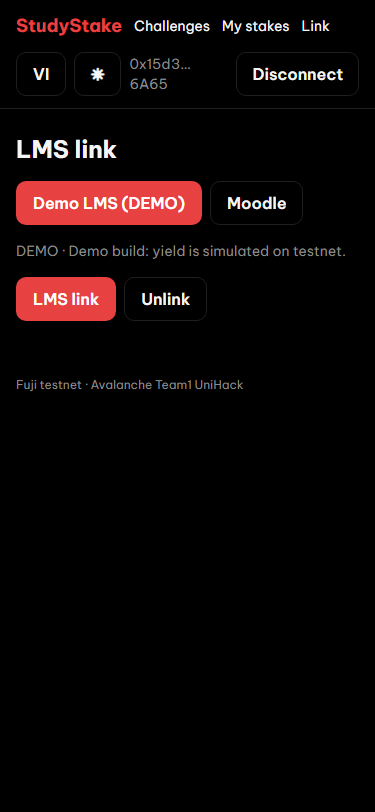
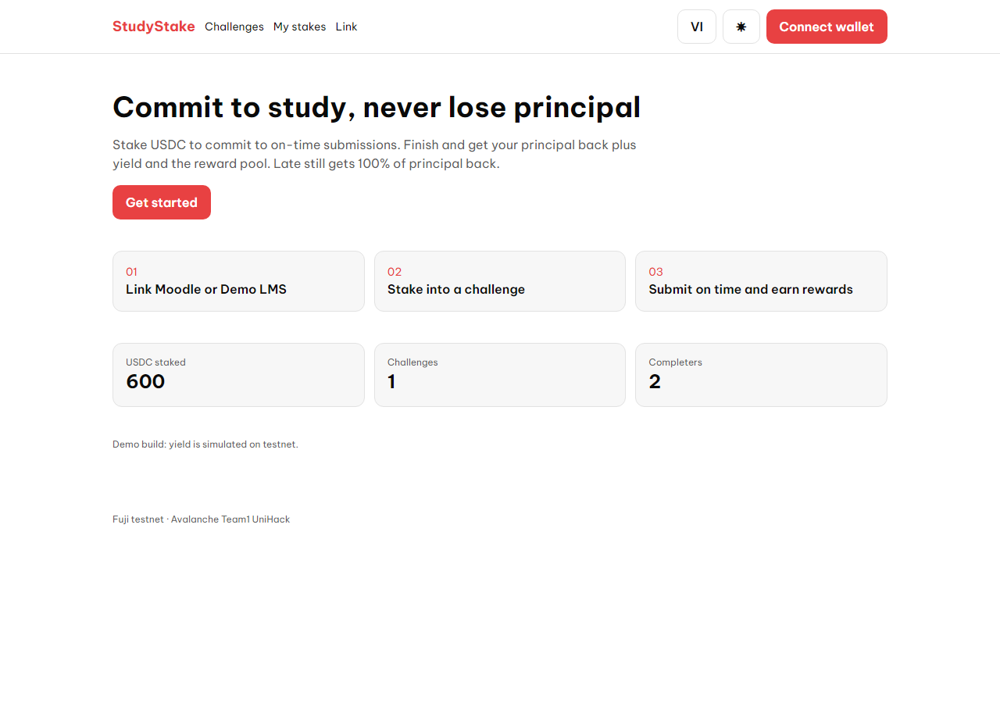

<div align="center">

<h1>StudyStake</h1>


<p><b>Commit to studying. Never lose your principal.</b></p>

<p>
  <a href="LICENSE"></a>
  
  
  
  
  
  
</p>

<p>
  
  
  
  <a href="https://github.com/ndgthuan/studystake/stargazers"></a>
  <a href="https://github.com/ndgthuan/studystake/commits"></a>
</p>

<p>
  <a href="docs/SPEC.md"><b>Spec</b></a> &nbsp;·&nbsp;
  <a href="docs/THREAT_MODEL.md"><b>Threat model</b></a> &nbsp;·&nbsp;
  <a href="docs/CONTRACTS.md"><b>Contracts</b></a> &nbsp;·&nbsp;
  <a href="docs/ORACLE.md"><b>Oracle</b></a>
</p>
<p><i>(design docs are in Vietnamese)</i></p>



</div>

StudyStake is a dApp on **Avalanche** (C-Chain; the demo targets the Fuji testnet) that helps students keep their Moodle submission deadlines. Students stake USDC, and the deposit goes into a yield vault. Students who complete their work get their principal back, plus a share of the pool's yield and a sponsor bonus. Students who miss the deadline still get back **100% of their principal** and forfeit only the bonus.

This project is part of **Team1 Vietnam UniHack** (Avalanche).

## Screenshots

### Desktop


### Mobile

<div align="center">
<table align="center" width="100%">
  <tr>
    <td width="25%" align="center"><br><b>Challenge detail</b></td>
    <td width="25%" align="center"><br><b>Profile</b></td>
    <td width="25%" align="center"><br><b>Moodle link</b></td>
    <td width="25%" align="center"><br><b>Challenge list</b></td>
  </tr>
</table>
</div>

<details>
<summary>More images (desktop, light mode)</summary>

| Verify page (dark) | Challenge detail (dark) |
| :---: | :---: |
|  |  |
|  |  |

</details>

Other images (light mode, admin, challenge list, Moodle link) are in [`web/screenshots/`](web/screenshots/).

## Problem

Students often miss quiz and assignment deadlines on Moodle because they lack short-term motivation. Reminder apps are frequently ignored. "Betting" models such as StickK and Beeminder can feel like gambling, and the risk of losing real money keeps people from trying them.

StudyStake uses a **no-loss** mechanism: nobody loses their principal. Motivation comes from three sources: the pool's yield is paid only to those who complete their work, a reward fund from the school, a club or a sponsor, and soulbound badges plus public on-chain streaks.

## How it works

1. **Sign in** with Google via Privy. Users get an embedded wallet, so no MetaMask or seed phrase is needed. External wallets still work.
2. **Link Moodle** using a Moodle mobile token. The oracle determines the `userid` and binds `(site, userid) ↔ wallet` one-to-one.
3. **Stake** 1–100 USDC in **one transaction** (EIP-2612 `permit` + join).
4. **Stake → vault earns yield → Moodle/Demo LMS oracle → Merkle settle → dispute window → claim.** The oracle reads submission status, builds a Merkle root, and posts it to the contract along with an evidence hash. A dispute window follows before the result is finalized.
5. **Receive funds:** completers get their principal, a share of the yield in proportion to their stake, the sponsor reward, and a soulbound badge (streak +1). Non-completers get their principal back.

Principle: **everyone keeps their principal.** Yield and rewards are shared only among completers.

## Architecture

```
┌──────────────┐  Privy auth   ┌──────────────────────────┐
│  web (Next)  │──────────────▶│  oracle (CF Worker)       │
│ Privy+wagmi  │  link/status  │  - Moodle adapter         │
│ viem, i18n   │◀──────────────│  - Demo LMS adapter       │
└──────┬───────┘               │  - Merkle builder         │
       │ tx (join/claim)       │  - faucet drip            │
       ▼                       │  - cron: settle()         │
┌─────────────────────────────┐└───────┬──────────────────┘
│ Avalanche Fuji C-Chain       │◀───────┘ settle(root, evidence_hash)
│  StudyStakeManager           │
│  ├─ IYieldSource → MockYieldVault (ERC-4626, Fuji)       │
│  │                 AaveV3Adapter (mainnet, roadmap)       │
│  └─ StudyBadge (ERC-721 soulbound, ERC-5192)             │
└─────────────────────────────┘
Evidence (JSON, hashes only, no names): Cloudflare R2; keccak stored on-chain
```

Monorepo:

| Directory | Contents |
|---|---|
| `contracts/` | Foundry, Solidity 0.8.28, OpenZeppelin v5 |
| `oracle/` | Cloudflare Worker, TypeScript, viem, KV + R2 |
| `web/` | Next.js App Router, Privy, wagmi/viem, Tailwind, Vietnamese/English UI, pure-black dark mode |
| `docs/` | Specs and technical documentation |

## Avalanche integration

**Done (code + tests on local Anvil; Fuji deploy in progress):**

| Item | Status | Notes |
|---|:---:|---|
| ERC-4626 mock vault (`MockYieldVault`) as the yield source | ✓ | Simulated yield on testnet |
| Settle via Merkle root with evidence hash | ✓ | |
| Soulbound badge (ERC-721 + ERC-5192) with on-chain SVG | ✓ | |
| One-transaction stake via EIP-2612 `permit` | ✓ | |
| Privy embedded wallet (Google sign-in, optional) | ✗ | Code integrated, not yet tried with a real App ID |
| AVAX gas faucet for new users (oracle Worker) | ✓ | |

**Roadmap (not started):**
- Aave v3 adapter for C-Chain mainnet (real yield)
- x402 "Study Reputation API"
- StudyNet, a dedicated L1 for the school, via Builder Console, with ICM
- zkTLS (Reclaim/TLSNotary) to replace the trusted oracle

## Security

Details on threats and mitigations: [`docs/THREAT_MODEL.md`](docs/THREAT_MODEL.md).

**Core guarantee:** even if the oracle, creator, guardian or admin is compromised, users can still withdraw their principal (unless the yield vault itself takes a loss).
- No admin function can withdraw principal.
- `claim` and `expire` are never paused; pause blocks only `join` and `settle`.
- The oracle cannot touch principal. It only decides rewards, and rewards are capped by the rest of the pool.
- Evidence is public and contains no names or student IDs. The `/verify` page lets anyone check it.

**Residual risks (stated explicitly):** the vault can lose money; rewards depend on an honest oracle until zkTLS is in place; Moodle tokens are stored encrypted and require the user's consent on privacy.

## Test status

| Component | Tests | Command |
|---|---|---|
| Contracts (Foundry) | 92 tests, including fuzz and invariant; `StudyStakeManager` ~98% line coverage | `forge test` |
| Oracle (Worker) | 100 vitest tests + E2E on Anvil | `npm test`, `npm run e2e:anvil` |
| Web (Next.js) | 34 vitest tests + Playwright E2E on Anvil | `npm test`, `npm run e2e` |
| **Total** | **226** | |

## Deployment addresses

| Network | Contract | Address |
|---|---|---|
| Avalanche Fuji | StudyStakeManager | Fuji: to be updated soon (TBD) |
| Avalanche Fuji | MockYieldVault | Fuji: to be updated soon (TBD) |
| Avalanche Fuji | StudyBadge | Fuji: to be updated soon (TBD) |

## Documentation

- [`docs/SPEC.md`](docs/SPEC.md): specification and user flows
- [`docs/CONTRACTS.md`](docs/CONTRACTS.md): smart contracts
- [`docs/ORACLE.md`](docs/ORACLE.md): Cloudflare Worker oracle
- [`docs/WEB.md`](docs/WEB.md): web application
- [`docs/THREAT_MODEL.md`](docs/THREAT_MODEL.md): threat model

## Run locally

<details>
<summary><b>Local setup instructions</b></summary>

Clone with submodules (Foundry dependencies live in `contracts/lib/`):

```bash
git clone --recurse-submodules https://github.com/ndgthuan/studystake.git
cd studystake
```

If you already cloned without submodules: `git submodule update --init --recursive`.

**Contracts:**
```bash
cd contracts
forge test
```

**Oracle:**
```bash
cd oracle
npm i
npm test
npm run e2e:anvil
```
Create `oracle/.dev.vars` from `oracle/.dev.vars.example` to run `npm run dev`. This file is git-ignored and must not be committed.

**Web:**
```bash
cd web
npm i --legacy-peer-deps
npm run sync      # sync deployment addresses into web
npm run dev
```
Create `web/.env.local` (do not commit it).

</details>

## Project layout

```text
contracts/      Foundry, Solidity 0.8.28 (smart contracts)
oracle/         Cloudflare Worker (TypeScript): Moodle adapter, Demo LMS adapter, Merkle builder
web/            Next.js App Router: Privy, wagmi/viem, Tailwind, Vietnamese/English UI
docs/           Specs and technical documentation
assets/         Logo and banner for the README
```

## Team

- Nguyễn Dương Gia Thuận
- Nguyễn Kiều Anh Quân

## License

MIT. See [LICENSE](LICENSE).
