<p align="center">
  <picture>
    <source media="(prefers-color-scheme: dark)" srcset="assets/cover-dark.svg">
    <source media="(prefers-color-scheme: light)" srcset="assets/cover-light.svg">
    
  </picture>
</p>

<p align="center">
  <b><a href="#why-studystake">Why</a></b> &nbsp;·&nbsp;
  <b><a href="#features">Features</a></b> &nbsp;·&nbsp;
  <b><a href="#how-it-works">How it works</a></b> &nbsp;·&nbsp;
  <b><a href="#guarantees">Guarantees</a></b> &nbsp;·&nbsp;
  <b><a href="#quick-start">Quick start</a></b>
</p>

<p align="center">
  <a href="LICENSE"></a>
  
  
  
  
</p>

<p align="center">
  Part of <b>Team1 Vietnam UniHack 2026</b> on Avalanche. &nbsp;·&nbsp;
  Specs: <a href="docs/SPEC.md">Spec</a> · <a href="docs/THREAT_MODEL.md">Threat model</a> · <a href="docs/CONTRACTS.md">Contracts</a> · <a href="docs/ORACLE.md">Oracle</a> · <a href="docs/WEB.md">Web</a> · <a href="docs/X402.md">x402 Credential</a>
</p>

---

## Why StudyStake

Students miss Moodle quizzes and assignment deadlines. Reminder apps are easy to ignore. Betting-style commitment apps such as StickK and Beeminder add real stakes, but they feel like gambling, and losing real money puts many people off trying them.

StudyStake takes a different route. A student stakes between 1 and 100 USDC on a challenge such as "CSC10002 quiz, weeks 10 to 12". Finishing the work returns the principal plus a share of the pool's yield and a sponsor bonus. Missing the deadline still returns 100% of the principal. Only the yield and bonus are shared among completers.

Stakes, yield shares, and proofs are settled through a Merkle root on Avalanche, so anyone can verify the payout math instead of trusting a company that holds the money.

## Features

<table>
  <tr>
    <td align="center" valign="top" width="50%">
      <picture>
        <source media="(prefers-color-scheme: dark)" srcset="assets/feature-noloss-dark.svg">
        <source media="(prefers-color-scheme: light)" srcset="assets/feature-noloss-light.svg">
        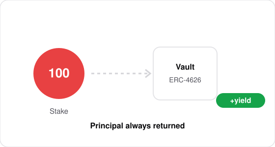
      </picture>
      <h3>No-loss staking</h3>
      <p>Your stake sits in an ERC-4626 yield vault. Your principal always comes back; only the yield is shared among students who finished.</p>
    </td>
    <td align="center" valign="top" width="50%">
      <picture>
        <source media="(prefers-color-scheme: dark)" srcset="assets/feature-oracle-dark.svg">
        <source media="(prefers-color-scheme: light)" srcset="assets/feature-oracle-light.svg">
        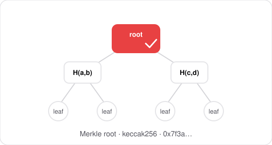
      </picture>
      <h3>Verifiable oracle</h3>
      <p>The oracle posts a Merkle root and an evidence hash on-chain. Anyone can re-check the evidence in the browser.</p>
    </td>
  </tr>
  <tr>
    <td align="center" valign="top" width="50%">
      <picture>
        <source media="(prefers-color-scheme: dark)" srcset="assets/feature-streaks-dark.svg">
        <source media="(prefers-color-scheme: light)" srcset="assets/feature-streaks-light.svg">
        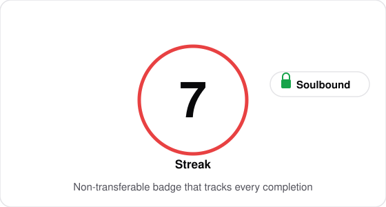
      </picture>
      <h3>Soulbound streaks</h3>
      <p>A non-transferable ERC-721 badge (ERC-5192) records your completions and streak on-chain. It is yours and cannot be sold.</p>
    </td>
    <td align="center" valign="top" width="50%">
      <picture>
        <source media="(prefers-color-scheme: dark)" srcset="assets/feature-onboarding-dark.svg">
        <source media="(prefers-color-scheme: light)" srcset="assets/feature-onboarding-light.svg">
        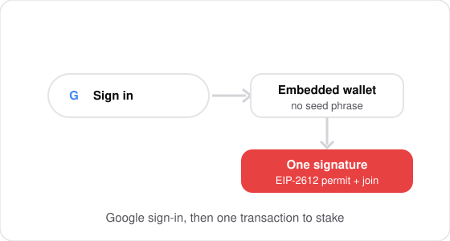
      </picture>
      <h3>One-transaction onboarding</h3>
      <p>Sign in with Google through Privy, then stake with a single EIP-2612 permit signature. No seed phrase, no separate approval.</p>
    </td>
  </tr>
</table>

## How it works

<p align="center">
  <picture>
    <source media="(prefers-color-scheme: dark)" srcset="assets/architecture-dark.svg">
    <source media="(prefers-color-scheme: light)" srcset="assets/architecture-light.svg">
    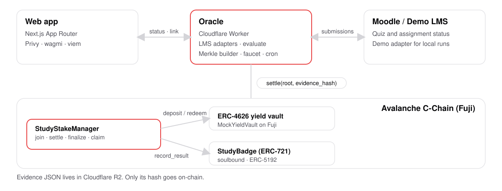
  </picture>
</p>

**Components**

- **Web app** (`web/`): Next.js App Router with Privy sign-in, wagmi and viem, and Vietnamese and English UI.
- **Oracle** (`oracle/`): Cloudflare Worker in TypeScript. It has a Moodle adapter, a Demo LMS adapter, an evaluator, the Merkle builder, the AVAX faucet, and a cron job that settles challenges.
- **Evidence store:** public evidence JSON in Cloudflare R2. Only its hash goes on-chain, and the evidence contains no names or student IDs.
- **StudyStakeManager** (`contracts/`): holds challenges, stakes, sponsor bonuses, settlement, disputes, and claims.
- **MockYieldVault:** ERC-4626 yield source used on Fuji. Its yield is simulated.
- **StudyBadge:** soulbound ERC-721 streak badge (ERC-5192).

**Lifecycle**

1. **Join.** Sign in, link your Moodle token, and stake 1 to 100 USDC with one `join_with_permit` transaction. The stake goes into the vault and earns yield while the deadline runs.
2. **Submit.** Complete the quiz or assignment in Moodle as usual.
3. **Settle.** After the end time, the oracle reads submission status, builds the Merkle root of completers, and calls `settle(root, completed_count, completed_stake, evidence_hash)`.
4. **Dispute window.** Anyone who staked can dispute the result during the window (24 hours in production, 10 minutes in the demo). A guardian can then replace the root.
5. **Finalize.** Anyone can call `finalize`. It redeems all vault shares and fixes the reward pot.
6. **Claim.** Each student claims once. Completers receive principal, a yield share, and the reward. The badge is minted on first completion, and the streak goes up by one.

Principle: **everyone keeps their principal.** Yield and rewards are shared only among students who completed their work.

### Payout example

<p align="center">
  <picture>
    <source media="(prefers-color-scheme: dark)" srcset="assets/payout-dark.svg">
    <source media="(prefers-color-scheme: light)" srcset="assets/payout-light.svg">
    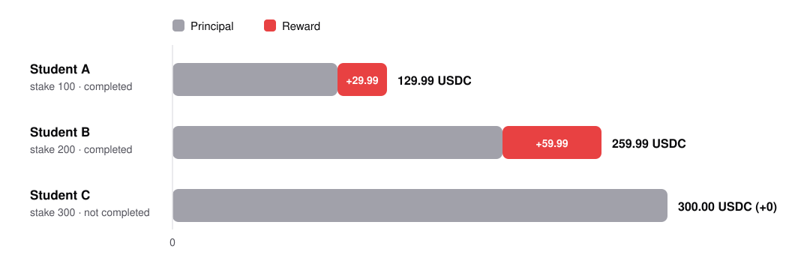
  </picture>
</p>

*Real numbers from the end-to-end test on local Anvil: 60 USDC simulated yield + 30 USDC sponsor bonus, split pro-rata between completers. Nobody loses principal.*

## Product tour

<table>
  <tr>
    <td align="center" valign="top" width="50%">
      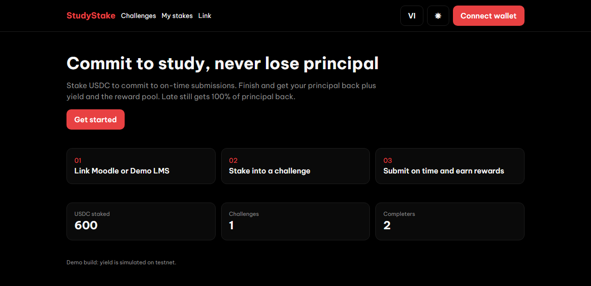
      <sub><b>Landing.</b> The entry point: challenges, the pitch in one line, and sign-in.</sub>
    </td>
    <td align="center" valign="top" width="50%">
      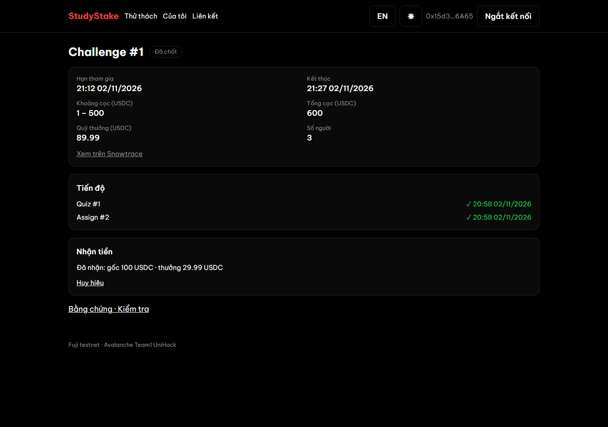
      <sub><b>Challenge detail.</b> Stake range, deadline, pool size, and the state you are in.</sub>
    </td>
  </tr>
  <tr>
    <td align="center" valign="top" width="50%">
      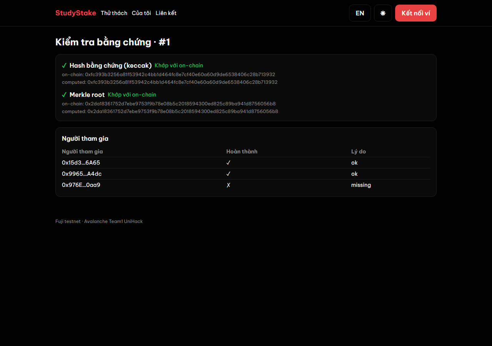
      <sub><b>Verify.</b> Anyone can re-check the oracle's evidence in the browser.</sub>
    </td>
    <td align="center" valign="top" width="50%">
      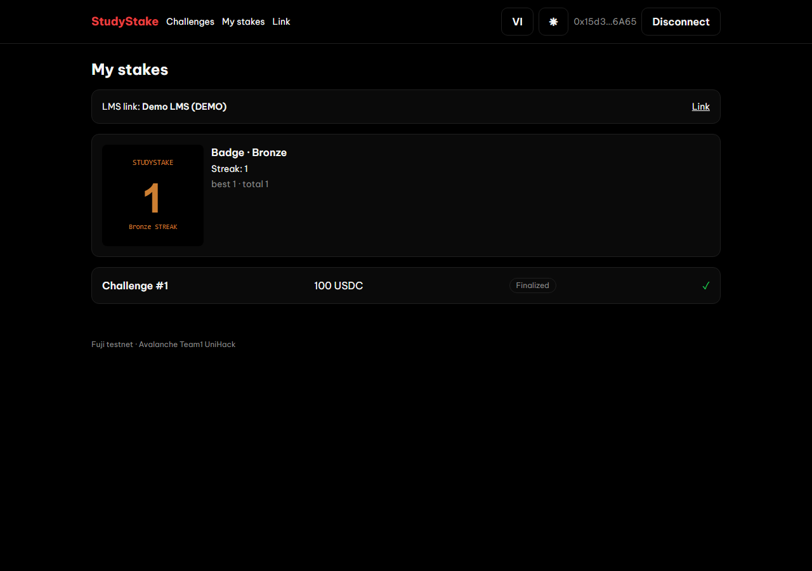
      <sub><b>Profile.</b> Your account view at desktop width.</sub>
    </td>
  </tr>
</table>

<table>
  <tr>
    <td align="center" valign="top">
      
    </td>
    <td align="center" valign="top">
      
    </td>
  </tr>
</table>

<p align="center"><sub>More captures, including light mode, the admin view, the challenge list, and the Moodle link, are in <a href="web/screenshots/"><code>web/screenshots/</code></a>.</sub></p>

## Guarantees

The core guarantee: even if the oracle, creator, guardian, or admin is compromised, users can still withdraw their principal, unless the yield vault itself takes a loss.

1. **Principal is always withdrawable.** No admin function can withdraw principal. Vault losses are shared pro rata, see [`StudyStakeManager.t.sol`](contracts/test/StudyStakeManager.t.sol).
2. **`claim` and `expire` are never paused.** Pause blocks only `join` and `settle`, see [`StudyStakeManager.t.sol`](contracts/test/StudyStakeManager.t.sol).
3. **The oracle cannot move principal.** It only sets the reward split, and an under-reported stake is still capped by the reward pot, see [`StudyStakeManager.t.sol`](contracts/test/StudyStakeManager.t.sol).
4. **Rewards are capped by the pot.** Total rewards paid never exceed `reward_pot`, and only unclaimed rewards are swept to the treasury after 180 days, see [`StudyStakeManager.t.sol`](contracts/test/StudyStakeManager.t.sol).
5. **One claim per address.** A second `claim` reverts with `AlreadyClaimed`, see [`StudyStakeManager.t.sol`](contracts/test/StudyStakeManager.t.sol).

Invariant and fuzz coverage: [`StudyStakeFuzz.t.sol`](contracts/test/StudyStakeFuzz.t.sol) and [`invariant/`](contracts/test/invariant/).

Full threat list and residual risks: [`docs/THREAT_MODEL.md`](docs/THREAT_MODEL.md).

## Avalanche integration

- [x] **ERC-4626 yield vault.** `MockYieldVault` is the yield source. Its yield is simulated on testnet.
- [x] **Merkle settlement with evidence hash.** The oracle posts a root plus a hash of public evidence, so results are auditable without names or student IDs.
- [x] **Soulbound badge (ERC-721 + ERC-5192).** Completion streaks are on-chain and non-transferable.
- [x] **One-transaction stake via EIP-2612 `permit`.** The user signs once, with no separate approval.
- [x] **AVAX gas faucet for new users.** Provided by the oracle Worker so first-time users can transact.
- [ ] **Privy embedded wallet (Google sign-in).** Code is integrated, but it has not been tried with a real App ID.
- [ ] **Aave v3 adapter on C-Chain mainnet.** Real yield. Roadmap, not started.
- [ ] **x402 "Study Reputation API".** Roadmap, not started.
- [ ] **StudyNet L1 for the school (ICM, Builder Console).** Roadmap, not started.
- [ ] **zkTLS (Reclaim or TLSNotary) to replace the trusted oracle.** Roadmap, not started.

## Quality

| Component | Tests | Command |
|---|---|---|
| Contracts (Foundry) | 92, including fuzz and invariant. `StudyStakeManager` at about 98% line coverage. | `forge test` |
| Oracle (Cloudflare Worker) | 100 vitest tests plus E2E on Anvil | `npm test`, `npm run e2e:anvil` |
| Web (Next.js) | 34 vitest tests plus Playwright E2E on Anvil | `npm test`, `npm run e2e` |
| **Total** | **226** | |

> [!NOTE]
> Honesty notes:
> - Everything has been built and tested on **local Anvil only**. The Fuji deployment is in progress and the contract addresses are TBD.
> - **Yield is simulated** on testnet by `MockYieldVault`. It is not real market yield.
> - **Privy is integrated but untested** with a real App ID.
> - Rewards depend on an honest oracle until zkTLS replaces it.

## Quick start

1. **Clone with submodules.** Foundry dependencies live in `contracts/lib/`.

   ```bash
   git clone --recurse-submodules https://github.com/ndgthuan/studystake.git
   cd studystake
   ```

   If you already cloned without submodules, run `git submodule update --init --recursive`.

2. **Run the contract tests.**

   ```bash
   cd contracts
   forge test
   ```

3. **Run the oracle tests.**

   ```bash
   cd oracle
   npm i
   npm test
   npm run e2e:anvil
   ```

   To start the Worker, create `oracle/.dev.vars` from `oracle/.dev.vars.example`, then run `npm run dev`. This file is git-ignored and must never be committed.

4. **Start the web app.**

   ```bash
   cd web
   npm i --legacy-peer-deps
   npm run sync      # copy deployment addresses into web
   npm run dev
   ```

   Create `web/.env.local` for your keys. Do not commit it.

> [!IMPORTANT]
> `.dev.vars` and `.env.local` hold secrets. Both are git-ignored. Keep them out of commits and screenshots.

## Repository layout

```text
contracts/   Foundry, Solidity 0.8.28 (StudyStakeManager, StudyBadge, mocks)
oracle/      Cloudflare Worker (TypeScript): Moodle adapter, Demo LMS adapter, Merkle builder
web/         Next.js App Router: Privy, wagmi/viem, Tailwind, Vietnamese/English UI
docs/        Spec, contracts, threat model, oracle and web notes
assets/      Images for this README (cover, architecture, features, payout chart)
```

## Team

- Nguyễn Dương Gia Thuận
- Nguyễn Kiều Anh Quân

## License

MIT. See [LICENSE](LICENSE).
