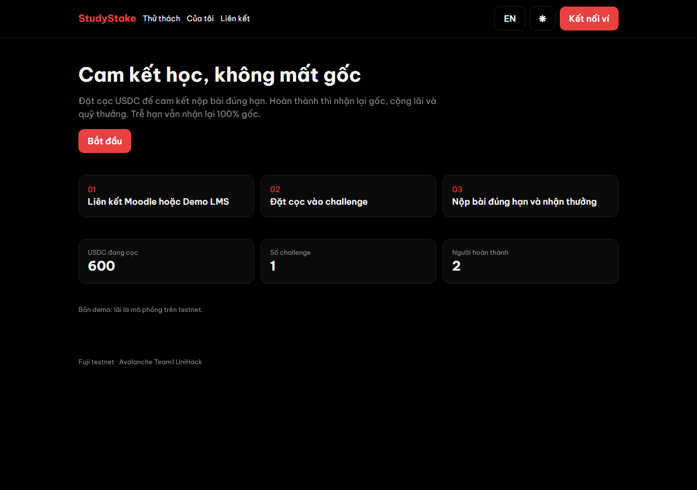
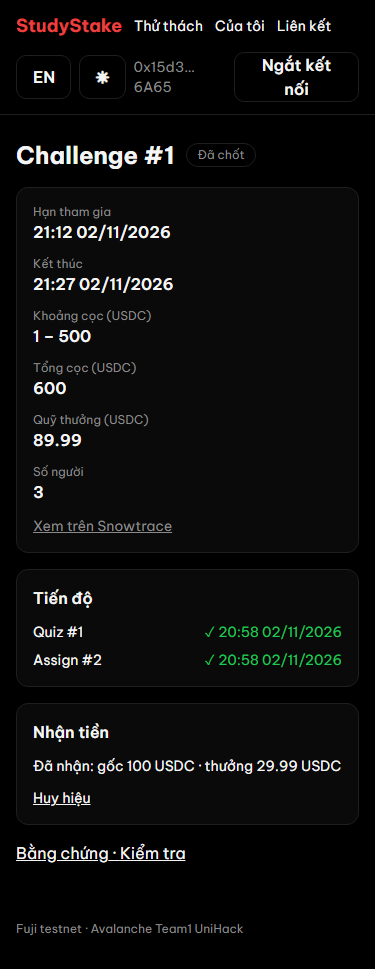
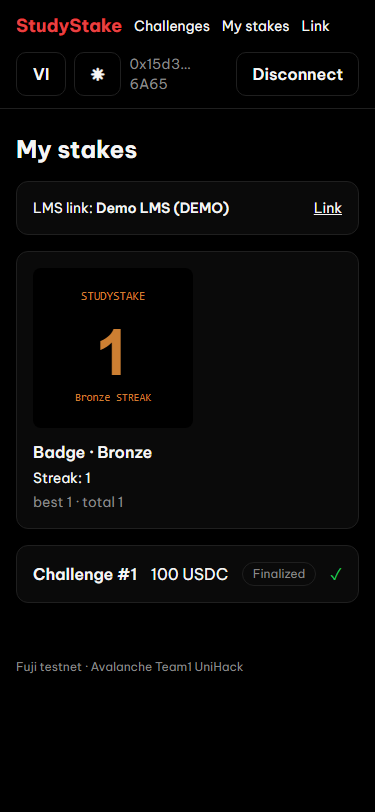
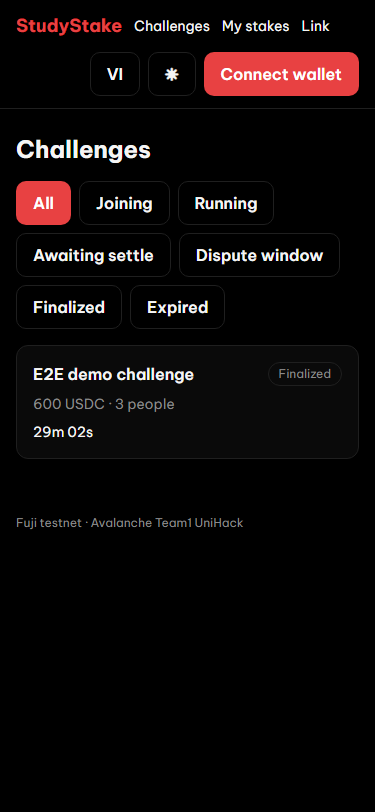
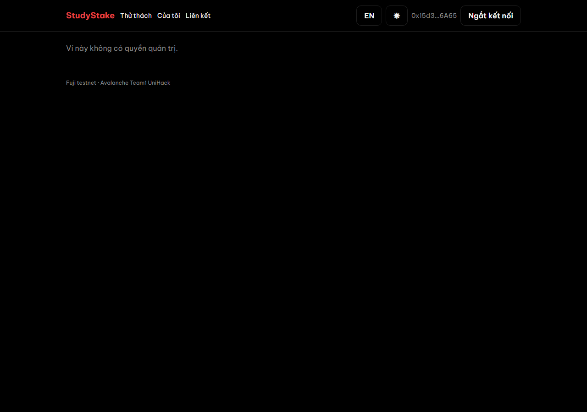

<div align="center">

<h1>StudyStake</h1>


<p><b>Cam kết học, không mất gốc.</b></p>
<p><i>Commit to studying, never lose your principal.</i></p>

<p>
  <a href="LICENSE"></a>
  
  
  
  
  
  
</p>

<p>
  
  
  
  <a href="https://github.com/ndgthuan/studystake/stargazers"></a>
  <a href="https://github.com/ndgthuan/studystake/commits"></a>
</p>

<p>
  <a href="docs/SPEC.md"><b>Tài liệu</b></a> &nbsp;·&nbsp;
  <a href="docs/THREAT_MODEL.md"><b>Threat model</b></a> &nbsp;·&nbsp;
  <a href="docs/CONTRACTS.md"><b>Kiến trúc contract</b></a> &nbsp;·&nbsp;
  <a href="docs/ORACLE.md"><b>Oracle</b></a>
</p>


</div>

StudyStake là dApp trên **Avalanche** (C-Chain; bản demo nhắm Fuji testnet) giúp sinh viên giữ cam kết nộp bài Moodle đúng hạn. Sinh viên đặt cọc USDC, tiền cọc chạy vào vault sinh lãi. Người hoàn thành nhận lại gốc cộng phần lãi của cả nhóm và quỹ thưởng tài trợ. Người trễ hạn vẫn nhận lại **100% gốc**, chỉ mất phần thưởng.

Dự án tham gia **Team1 Vietnam UniHack** (Avalanche).

## Ảnh chụp màn hình

### Desktop



### Mobile

<div align="center">
<table align="center" width="100%">
  <tr>
    <td width="25%" align="center"><br><b>Chi tiết challenge</b></td>
    <td width="25%" align="center"><br><b>Hồ sơ cá nhân</b></td>
    <td width="25%" align="center"><br><b>Liên kết Moodle</b></td>
    <td width="25%" align="center"><br><b>Danh sách challenge</b></td>
  </tr>
</table>
</div>

<details>
<summary>Thêm ảnh (desktop, light mode)</summary>

| Trang xác minh (dark) | Chi tiết challenge (dark) |
| :---: | :---: |
|  |  |
|  |  |

</details>

Các ảnh khác (light mode, admin, danh sách challenge, liên kết Moodle) nằm trong [`web/screenshots/`](web/screenshots/).

## Vấn đề

Sinh viên hay trễ quiz và bài nộp trên Moodle vì thiếu động lực ngắn hạn. App nhắc lịch thường bị bỏ qua. Các mô hình "cược tiền" (StickK, Beeminder) dễ gây cảm giác cờ bạc, và việc mất tiền thật khiến người dùng ngại thử.

StudyStake dùng cơ chế **no-loss**: không ai mất gốc. Động lực đến từ ba nguồn: lãi của cả pool chỉ chia cho người hoàn thành, quỹ thưởng của trường/CLB/nhà tài trợ, và huy hiệu soulbound cùng chuỗi ngày (streak) công khai on-chain.

## Cách hoạt động

1. **Đăng nhập** bằng Google qua Privy. Người dùng có ví embedded, không cần MetaMask hay seed phrase. Ví ngoài vẫn dùng được.
2. **Liên kết Moodle** bằng Moodle mobile token. Oracle xác định `userid` và ràng buộc `(site, userid) ↔ ví` một-một.
3. **Đặt cọc** 1–100 USDC trong **một giao dịch** (EIP-2612 `permit` + join).
4. **Stake → vault sinh lãi → Moodle/Demo LMS oracle → Merkle settle → cửa sổ khiếu nại → claim.** Oracle đọc trạng thái nộp bài, tạo Merkle root và đưa lên contract cùng hash bằng chứng. Sau đó có cửa sổ khiếu nại trước khi chốt kết quả.
5. **Nhận tiền:** người hoàn thành nhận gốc, phần lãi chia theo cọc, phần thưởng tài trợ và huy hiệu SBT (streak +1). Người không hoàn thành nhận lại gốc.

Nguyên tắc: **mọi người đều giữ nguyên gốc.** Lãi và thưởng chỉ chia cho người hoàn thành.

## Kiến trúc

```
┌──────────────┐  Privy auth   ┌──────────────────────────┐
│  web (Next)  │──────────────▶│  oracle (CF Worker)       │
│ Privy+wagmi  │  link/status  │  - Moodle adapter         │
│ viem, i18n   │◀──────────────│  - Demo LMS adapter       │
└──────┬───────┘               │  - Merkle builder         │
       │ tx (join/claim)       │  - faucet drip            │
       ▼                       │  - cron: settle()         │
┌─────────────────────────────┐└───────┬──────────────────┘
│ Avalanche Fuji C-Chain       │◀───────┘ settle(root, evidence_hash)
│  StudyStakeManager           │
│  ├─ IYieldSource → MockYieldVault (ERC-4626, Fuji)       │
│  │                 AaveV3Adapter (mainnet, roadmap)       │
│  └─ StudyBadge (ERC-721 soulbound, ERC-5192)             │
└─────────────────────────────┘
Bằng chứng (JSON, chỉ chứa hash, không có tên): Cloudflare R2, keccak lưu on-chain
```

Monorepo:

| Thư mục | Nội dung |
|---|---|
| `contracts/` | Foundry, Solidity 0.8.28, OpenZeppelin v5 |
| `oracle/` | Cloudflare Worker, TypeScript, viem, KV + R2 |
| `web/` | Next.js App Router, Privy, wagmi/viem, Tailwind, giao diện Việt/Anh, dark mode nền đen tuyền |
| `docs/` | Đặc tả và tài liệu kỹ thuật |

## Tích hợp Avalanche

**Đã làm (code + test trên Anvil local; deploy Fuji đang chuẩn bị):**

| Hạng mục | Trạng thái | Ghi chú |
|---|:---:|---|
| Vault ERC-4626 mock (`MockYieldVault`) làm nguồn lãi | ✓ | Lãi mô phỏng trên testnet |
| Settle bằng Merkle root kèm hash bằng chứng | ✓ | |
| Huy hiệu soulbound (ERC-721 + ERC-5192) với SVG on-chain | ✓ | |
| Đặt cọc một giao dịch bằng EIP-2612 `permit` | ✓ | |
| Privy embedded wallet (đăng nhập Google, tùy chọn) | ✗ | Đã tích hợp code, chưa thử với App ID thật |
| Faucet gas AVAX cho người dùng mới (oracle Worker) | ✓ | |

**Lộ trình (chưa làm):**
- Adapter Aave v3 cho C-Chain mainnet (lãi thật)
- x402 "Study Reputation API"
- StudyNet L1 riêng cho trường, qua Builder Console, kèm ICM
- zkTLS (Reclaim/TLSNotary) thay cho oracle tin cậy

## Bảo mật

Chi tiết các mối đe dọa và cách chặn: [`docs/THREAT_MODEL.md`](docs/THREAT_MODEL.md).

**Bảo đảm cốt lõi:** dù oracle, creator, guardian hay admin bị hack, gốc của người dùng vẫn rút được (trừ khi chính vault sinh lãi bị lỗ).
- Không có hàm nào của admin rút được gốc.
- `claim` và `expire` không bị pause; pause chỉ chặn `join` và `settle`.
- Oracle không chạm được vào gốc. Nó chỉ quyết định phần thưởng, và thưởng bị chặn bởi phần còn lại của pool.
- Bằng chứng công khai, không chứa tên hay MSSV. Trang `/verify` cho phép tự kiểm tra.

**Rủi ro còn lại (ghi rõ):** vault có thể lỗ; phần thưởng phụ thuộc oracle trung thực cho đến khi có zkTLS; Moodle token được lưu mã hóa và cần người dùng đồng ý về quyền riêng tư.

## Trạng thái kiểm thử

| Thành phần | Kiểm thử | Lệnh |
|---|---|---|
| Contracts (Foundry) | 92 test, gồm fuzz và invariant; `StudyStakeManager` ~98% line coverage | `forge test` |
| Oracle (Worker) | 100 test vitest + E2E trên Anvil | `npm test`, `npm run e2e:anvil` |
| Web (Next.js) | 34 test vitest + E2E Playwright trên Anvil | `npm test`, `npm run e2e` |

## Địa chỉ deployment

| Mạng | Contract | Địa chỉ |
|---|---|---|
| Avalanche Fuji | StudyStakeManager | Fuji: sắp cập nhật (TBD) |
| Avalanche Fuji | MockYieldVault | Fuji: sắp cập nhật (TBD) |
| Avalanche Fuji | StudyBadge | Fuji: sắp cập nhật (TBD) |

## Tài liệu

- [`docs/SPEC.md`](docs/SPEC.md): đặc tả và luồng người dùng
- [`docs/CONTRACTS.md`](docs/CONTRACTS.md): smart contract
- [`docs/ORACLE.md`](docs/ORACLE.md): oracle Cloudflare Worker
- [`docs/WEB.md`](docs/WEB.md): ứng dụng web
- [`docs/THREAT_MODEL.md`](docs/THREAT_MODEL.md): mô hình đe dọa

## Chạy local

<details>
<summary><b>Hướng dẫn chạy local</b></summary>

Clone kèm submodule (dependency Foundry nằm trong `contracts/lib/`):

```bash
git clone --recurse-submodules https://github.com/ndgthuan/studystake.git
cd studystake
```

Nếu đã clone mà chưa có submodule: `git submodule update --init --recursive`.

**Contracts:**
```bash
cd contracts
forge test
```

**Oracle:**
```bash
cd oracle
npm i
npm test
npm run e2e:anvil
```
Tạo `oracle/.dev.vars` từ `oracle/.dev.vars.example` để chạy `npm run dev`. File này bị git ignore, không được commit.

**Web:**
```bash
cd web
npm i --legacy-peer-deps
npm run sync      # đồng bộ địa chỉ deployment vào web
npm run dev
```
Tạo `web/.env.local` (không commit).

</details>

## Cấu trúc thư mục

```text
contracts/      Foundry, Solidity 0.8.28 (smart contract)
oracle/         Cloudflare Worker (TypeScript): Moodle adapter, Demo LMS adapter, Merkle builder
web/            Next.js App Router: Privy, wagmi/viem, Tailwind, giao diện Việt/Anh
docs/           Đặc tả và tài liệu kỹ thuật
assets/         Logo và banner của README
```

## Đội ngũ

- Nguyễn Dương Gia Thuận
- Nguyễn Kiều Anh Quân

## Giấy phép

MIT. Xem [LICENSE](LICENSE).

---

## English summary

**StudyStake: "Commit to studying, never lose your principal."** Students stake USDC on meeting a Moodle deadline. The stake goes into an ERC-4626 vault that earns yield. Students who complete the work get their principal back, plus a share of the pool's yield and a sponsor bonus. Students who miss the deadline still get 100% of their principal back and forfeit only the bonus.

Flow: stake → vault yield → Moodle/Demo LMS oracle → Merkle settle → dispute window → claim. Principal can always be withdrawn, and `claim`/`expire` are never paused. The oracle cannot touch principal.

Built and tested on local Anvil (Fuji deploy in progress): MockYieldVault (ERC-4626), Merkle settlement, soulbound SBT with on-chain SVG, EIP-2612 permit join, optional Privy login, gas faucet. Roadmap: Aave v3 adapter for mainnet, x402, own L1, zkTLS. Deployed Fuji addresses are TBD. License: MIT.
